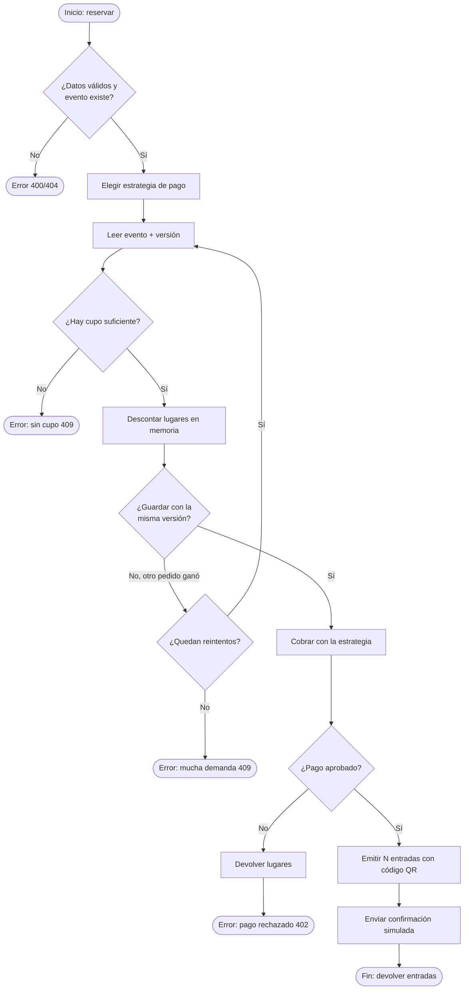

# Algoritmo: reserva de entradas con control de cupo (sin sobreventa)

**Código:** `server/src/services/ReservationService.ts` (método `reserve`) y `server/src/infrastructure/repositories/EventRepository.ts` (métodos `modify` y `saveIfUnchanged`).
**Prueba:** `server/tests/services/ReservationService.test.ts`: 20 pedidos simultáneos sobre un evento de 5 lugares terminan en exactamente 5 entradas y 0 lugares libres.

## Problema

Si dos personas reservan el último lugar al mismo tiempo, las dos leen "queda 1", las dos descuentan y el evento queda sobrevendido. El algoritmo tiene que garantizar que **nunca se emitan más entradas que el cupo**, aunque lleguen muchos pedidos en paralelo.

## Idea

1. La regla "no hay cupo suficiente" vive dentro de la clase `Event` (`reserveSeats`), que es la única que puede modificar el cupo (encapsulamiento).
2. Para que dos pedidos simultáneos no se pisen se usa **bloqueo optimista**: cada evento tiene un número de `version`. Solo se guarda si la versión en la base sigue siendo la que se leyó. Si alguien guardó antes, se vuelve a leer y se reintenta.
3. Si el pago falla después de tomar los lugares, se **compensa** devolviéndolos.

## Pseudocódigo

```
FUNCIÓN reservar(asistente, idEvento, cantidad, medioPago)
    // 1. Validaciones
    SI asistente no puede RESERVAR_ENTRADA ENTONCES error "Sin permiso"
    SI cantidad < 1 O cantidad > 10 ENTONCES error "Cantidad inválida"
    evento ← buscarEvento(idEvento)
    SI evento no existe ENTONCES error "El evento no existe"
    estrategia ← elegirEstrategiaDePago(evento, medioPago)   // patrón Strategy

    // 2-3. Tomar los lugares con bloqueo optimista
    evento ← modificarConReintentos(idEvento, e → e.reservarLugares(cantidad))

    // 4. Cobrar
    total ← evento.precio × cantidad
    resultadoPago ← estrategia.pagar(total)

    // 5. Compensación si el pago es rechazado
    SI NO resultadoPago.aprobado ENTONCES
        modificarConReintentos(idEvento, e → e.liberarLugares(cantidad))
        error "Pago rechazado"
    FIN SI

    // 6. Emitir una entrada por lugar
    entradas ← lista vacía
    REPETIR cantidad VECES
        agregar a entradas: nuevaEntrada(evento, asistente, resultadoPago)  // gratuita o paga, con código único
    FIN REPETIR
    guardarEntradas(entradas)

    // 7. Confirmación (simulada)
    enviarMailConfirmacion(asistente, evento, entradas)
    DEVOLVER entradas
FIN FUNCIÓN


FUNCIÓN modificarConReintentos(idEvento, cambio)
    PARA intento DESDE 1 HASTA 10 HACER
        evento ← leerEvento(idEvento)             // incluye evento.version
        cambio(evento)                            // puede lanzar "Sin cupo"
        filas ← ACTUALIZAR eventos
                   DONDE id = idEvento Y version = evento.version
                   PONER datos de evento, version = evento.version + 1
        SI filas = 1 ENTONCES DEVOLVER evento     // nadie lo modificó en el medio
        esperar un tiempo aleatorio corto          // otro pedido ganó: reintentar con datos nuevos
    FIN PARA
    error "Mucha demanda, intente nuevamente"
FIN FUNCIÓN


MÉTODO Evento.reservarLugares(cantidad)
    SI cantidad no es entero positivo ENTONCES error "Cantidad inválida"
    SI estado ≠ PUBLICADO O fecha ≤ ahora ENTONCES error "No admite reservas"
    SI cantidad > lugaresDisponibles ENTONCES error "Sin cupo suficiente"
    lugaresDisponibles ← lugaresDisponibles − cantidad
FIN MÉTODO
```

## Diagrama de flujo (Mermaid: GitHub lo muestra renderizado y draw.io lo importa desde el menú *Insertar > Avanzado > Mermaid*)



## Por qué funciona

- La condición `version = evento.version` hace que la escritura sea atómica en MongoDB: de N pedidos que leyeron la misma versión, **solo uno** logra guardar. Los demás releen el cupo actualizado y, si ya no hay lugar, `reserveSeats` lanza `SoldOutError`.
- No hace falta una transacción de base de datos ni un *lock* que bloquee el evento mientras se cobra.
- Complejidad: O(1) por intento para tomar los lugares y O(cantidad) para emitir entradas.
