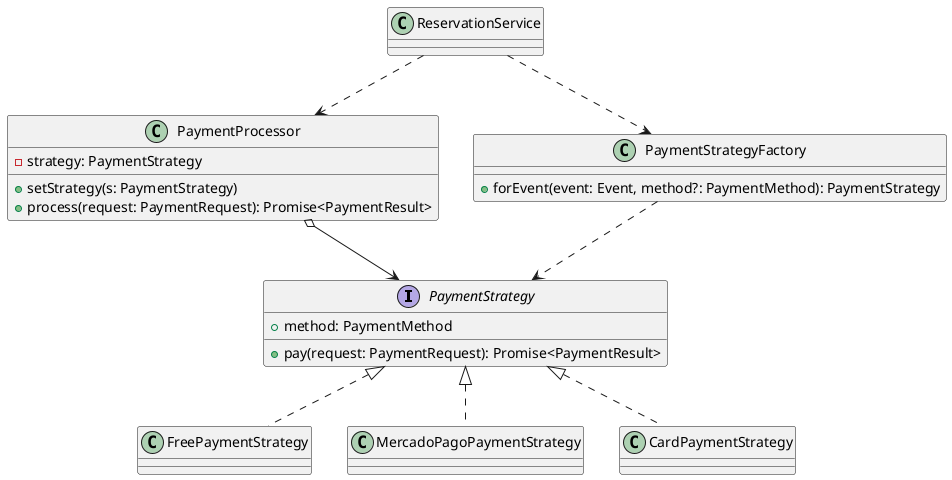

# Patrón de diseño aplicado: Strategy (medios de pago)

**Código:** `server/src/domain/payments/`

## Problema

Una entrada puede ser gratuita o paga, y si es paga se puede cobrar con Mercado Pago o con tarjeta (y en el futuro con otros medios). Si el algoritmo de reserva tuviera un `if (medio == ...)` por cada caso, habría que modificarlo cada vez que se agrega un medio de pago, lo que viola el principio abierto/cerrado.

## Solución

Cada medio de pago es una **estrategia** intercambiable que implementa la misma interfaz. El algoritmo de reserva solo conoce la interfaz.

| Rol en el patrón | Clase |
| --- | --- |
| Strategy (interfaz) | `PaymentStrategy` con `pay(request): Promise<PaymentResult>` |
| Estrategias concretas | `FreePaymentStrategy`, `MercadoPagoPaymentStrategy` (mock), `CardPaymentStrategy` (mock) |
| Context | `PaymentProcessor` (guarda una estrategia y le delega `process()`) |
| Cliente | `ReservationService` |
| Selección | `PaymentStrategyFactory.forEvent(event, method)` (evento gratuito → siempre `FreePaymentStrategy`) |

## Ventajas en este proyecto

- **Abierto/cerrado:** agregar "transferencia bancaria" es crear `BankTransferPaymentStrategy` y registrarla en la fábrica, sin tocar `ReservationService`.
- **Simulación sencilla:** las estrategias de Mercado Pago y tarjeta son *mocks* que siempre aprueban. Para pasar a producción se reemplaza el cuerpo de `pay()` por la llamada a la API real.
- **Testeable:** en las pruebas se inyecta una estrategia que siempre rechaza para verificar la compensación (se devuelven los lugares).
- **Polimorfismo:** el servicio llama `processor.process(...)` sin saber qué estrategia concreta hay detrás.
